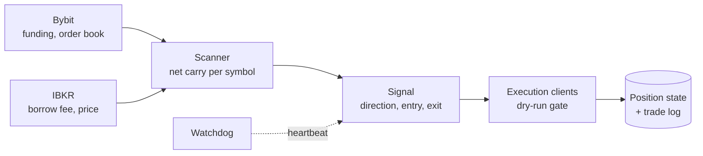
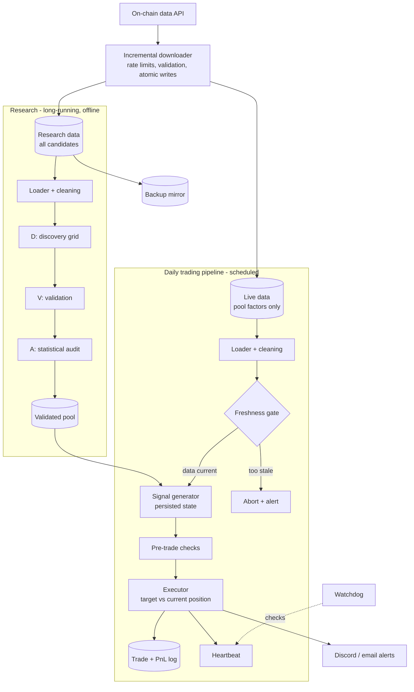

# Quant Trading Systems

Two trading systems I designed and built in Python: a delta-neutral funding-rate arbitrage bot that trades across a crypto exchange and a stock broker, and a research pipeline that screens and validates on-chain signals for long/short crypto trading.

The two are built to complement each other. The signal system takes a directional view, long or short, so it can profit when the market trends either way. The arbitrage system is market-neutral: price moves cancel out, and it earns from funding whether the market rises, falls or goes sideways. Together they cover most market conditions.

> This is a case study. The code is private because it contains strategy details. Code walkthrough available on request. It deliberately contains no parameters, thresholds, factor names or performance figures.

**Stack:** Python · pandas · NumPy · SciPy · CCXT · ib_insync · pytest · REST data APIs · Windows Task Scheduler · Discord webhooks

---

## At a glance

| | Funding-rate arbitrage | On-chain signal research |
|---|---|---|
| What it does | Holds a perp and the opposite stock position so price moves cancel, and collects the funding spread | Searches thousands of on-chain metrics for signals, then tries hard to prove each one is not luck |
| Market exposure | Market-neutral: designed to earn in rising, falling and sideways markets | Directional long/short: designed to profit when the market trends either way |
| Markets | Bybit TradFi perpetuals + Interactive Brokers | Bybit crypto perpetuals |
| Hardest part | Getting every cash flow's sign, currency and timing right, and failing safe with real orders | Not fooling myself: overfitting, look-ahead bias, and live behaviour drifting from the backtest |
| Tests | 26 pytest test files | 11 pytest test files |

---

## Part 1 — Funding-rate arbitrage

### The idea

A perpetual future never expires. To keep its price near the underlying, the exchange charges a periodic **funding** payment between longs and shorts. If I short the perp and hold the same amount of the real stock, a price move up or down makes one leg gain what the other loses, and what remains is the funding payment minus my costs.

The system supports both directions and picks one from live data:

- **Short perp + long stock** when funding is positive (shorts get paid).
- **Long perp + short stock** when funding is negative, after subtracting the stock borrow fee.

It scans every eligible stock and commodity perp on the exchange and rotates into whichever has the best net carry.

### Architecture

| Layer | Rule |
|---|---|
| `data/` | Fetchers for funding history, live funding, borrow fees and prices |
| `core/` | Pure backtest engine: DataFrames in, results out, **no network calls**, so it is fast and fully testable |
| `trading/` | Exchange and broker clients; every write method goes through a dry-run gate |
| `scripts/` | Entry points: backtest, rotating monitor, data collectors, watchdog |

### Correctness rules, each guarded by a test

- **Funding sign convention.** Shorts receive funding and longs pay it. A sign error would silently invert every profit and loss figure, so a dedicated test pins all four cases.
- **USDT is not USD.** The exchange settles in USDT and the broker in USD. They are tracked in separate fields with an explicit conversion assumption, never summed as if they were equal.
- **Real funding intervals.** The interval is read from the API per symbol instead of assuming 8 hours.
- **Short histories are flagged.** Many of these perps launched recently. Backtests clip to the launch date and mark short samples as insufficient instead of reporting them as results.
- **Return on capital, not gross spread.** Both legs need margin, so real capital is a multiple of notional. Results are reported against the capital actually required.

### Safe by default

- **Dry-run and testnet by default.** Real orders need an explicit `--live` flag plus an interactive confirmation.
- **One instance only.** A singleton lock stops two monitors from trading against the same state file.
- **Restart-safe.** Position state is persisted, so a restart resumes an open position, including a close that was deferred.
- **Market hours.** The perp trades 24/7 but the stock does not. When the stock market is closed, the monitor warns that one leg would be unhedged, and closes are deferred and re-checked instead of leaving a naked leg.
- **Orders are verified, not assumed.** After placing an order the client confirms the fill before treating the position as hedged.
- **Size to the market.** Position size is limited by order-book depth and by the exchange's position tier caps.

### Execution measured, not assumed

Backtests need a slippage assumption, and a wrong one decides whether the strategy is worth running. Instead of guessing:

- Every open and close attempt is logged with its execution type, the shortfall against the reference price in basis points, and the number of reprices, **including attempts that missed**, which would otherwise leave no record.
- A passive collector estimates how often a maker order would fill at different time windows **without placing any orders**, to settle the slippage assumption with data.
- A separate collector records perp-versus-stock basis for the research on the reverse direction.

### Design decision: one position, not a basket

High carry shows up as short-lived spikes on individual symbols, not as a stable condition across many. Fees are a fixed hurdle on every entry and switch, so the system holds one position in the best opportunity and rotates, backed by a switching-cost backtest. Exits also require several consecutive weak readings before closing, so it doesn't pay fees on noise.

### Running unattended

- The monitor and data collectors run as scheduled tasks on a desktop machine, each with its own watchdog task that checks a heartbeat file every few minutes and restarts what has stopped.
- Alerts go to Discord.
- Live stock prices come from a free source first and the broker only as a fallback, so a disconnected broker cannot cause a retry storm across the whole scan.

---

## Part 2 — On-chain signal research and daily trading

On-chain data providers publish thousands of metrics (exchange flows, holder behaviour, derivatives positioning). The system collects them, cleans them into one standard format, screens and validates them for long and short signals, and runs a daily pipeline that turns the validated pool into a position on the exchange. The data layer reads standardized time series, so it does not depend on any one provider.

### Architecture

The research side and the daily side read from **separate data folders**, downloaded independently. A multi-hour grid search can never block, lock or corrupt the file the live run is about to read.

### Data collection

- **Incremental.** Each metric is updated from its last stored timestamp, and a metric is skipped until its resolution says new data can exist, so a daily run only fetches what changed.
- **Rate-limit aware.** The downloader backs off on rate-limit responses and rotates API keys. Other errors are logged with the full request and response, and that metric is skipped for the run instead of stalling the rest.
- **Validated before and after.** Each file is checked before it is merged with new rows and again after.
- **Atomic writes.** New data is merged and written to a temporary file, then swapped in with an atomic rename, so a crash or power cut cannot leave a half-written file.
- **Backups.** The research dataset is periodically mirrored to a second drive.

### Data cleaning

Every source ends up as the same two-column `(timestamp, value)` series, so the rest of the system has one format to trust:

- Timestamp and value columns are detected automatically across the different file layouts a provider returns.
- Timestamps are normalized to UTC, rows are sorted, and duplicate timestamps are removed.
- Missing values are detected, reported as a pattern (how many, where, how long the gaps are) and handled by an explicit policy, never silently.
- A data-quality check runs on every load, and the loader caches results in-process so repeated research runs don't re-read the disk.
- **Publish lag is measured, not assumed.** I audited when each metric actually becomes available, and the backtest uses exactly that lag, so a signal never uses data it could not have had on the day.

### Research pipeline

| Stage | Step | What it does |
|---|---|---|
| **D** Discovery | D1–D3 | Data preview, then a coarse and a fine parameter grid per metric using deterministic Sobol sampling across parallel workers |
| **V** Validation | V1 | Parameter stability: do neighbouring parameters perform similarly, or is this a lucky spike? |
| | V2 | Ensemble parameters for fragile factors instead of one fragile optimum |
| | V3–V4 | Purged walk-forward validation over rolling windows |
| | V5 | Correlation pruning within and across semantic factor groups |
| | V6 | Leave-one-out contribution of each factor to the portfolio |
| | V7 | Portfolio backtest with all costs |
| **A** Audit | A1–B4 | Rank IC with Newey–West standard errors, multiple-testing correction, factor exposure, turnover, quantile and long/short decomposition, bootstrap confidence intervals |

Factors that pass are aggregated into one daily signal with correlation-aware weighting and a per-factor cap. The research pool and the production pool are separate files: research writes only to the first, and a pool is promoted to production by hand after validation.

### Daily trading pipeline

A scheduled task runs three steps in order: download, signal, execute.

1. **Download** refreshes only the live data folder, which holds just the metrics the production pool uses.
2. **Signal generation**
   - A **freshness gate** counts how many factors have current data. Missing data counts as stale, not as zero. If too many are stale, the run aborts and alerts instead of trading on a partial picture.
   - Signal state (rolling statistics and the current direction) is **persisted between days**, so the live signal is computed exactly the way the backtest computes it across a continuous run.
   - Each factor's live performance is tracked, and a factor that degrades is suspended and put on a cooling period automatically.
3. **Execution**
   - The signal is validated first: a missing or out-of-range target position stops the run as a likely upstream bug.
   - Pre-trade checks confirm the exchange is up, the spread is normal and volatility is not extreme, and stale open orders are cancelled.
   - The executor compares the target with the actual position on the exchange and trades only the difference, rounded to the exchange's lot size.
   - Every fill is logged with its slippage against the mark price, and results go to Discord.
4. The pipeline writes a **heartbeat only after all three steps succeed**. An independent watchdog task checks it, and alerts fall back to email if Discord is unavailable. A singleton lock prevents two runs overlapping.

### Accuracy safeguards

- **A three-way time split.** Parameters are fitted on one window, factors are selected on a second, and a third holdout window is observation only. The rescreen code refuses to remove a factor using holdout data.
- **Every backtest pays its costs.** Exchange fees, slippage, funding and execution lag are charged in every run. A cost-free number is never reported as realistic.
- **Pre-registered acceptance criteria.** Before a major rescreen, the acceptance thresholds are written into a document and committed, so git history proves they were not chosen after seeing the results.
- **Measurement error first.** Before comparing two configurations, I compute the standard error of the Sharpe ratio for that sample length, so differences smaller than the data can resolve are not treated as findings.
- **A null distribution for the entry gate.** The identical pipeline runs on metrics that were never selected, to measure how often pure chance clears the gate.
- **Simple benchmarks.** Results are compared against trivial timing rules, not only against buy-and-hold.
- **Live and backtest parity.** The live and backtest paths share one set of signal rules, use only data available at decision time, and are checked by a parity test.
- **Reviewed and audited.** Full code reviews of the backtest and live paths and an operational audit of the live-money failure paths, with every fix verified by a runnable check before it is closed.

---

## Practices across both

- **Tests first for money paths.** Sign conventions, sizing, order verification, deferred closes, restarts and watchdogs all have tests.
- **One branch and one findings document per experiment.** Each experiment closes with a written verdict, then either graduates into the core code or is deleted, with git history as the archive.
- **Reproducible research.** Deterministic sampling and fixed seeds, so a result can be re-run and checked.

## Further reading

I also write a beginner-friendly guide to how algorithmic trading works, from the origins of markets to signals, backtesting and portfolio construction: [Algorithmic trading guide](https://app.notion.com/p/Algorithmic-trading-guide-3635adef84cd80d8ad89e4f2dc924696).

---

*This project is for research and engineering practice. It is not investment advice.*
